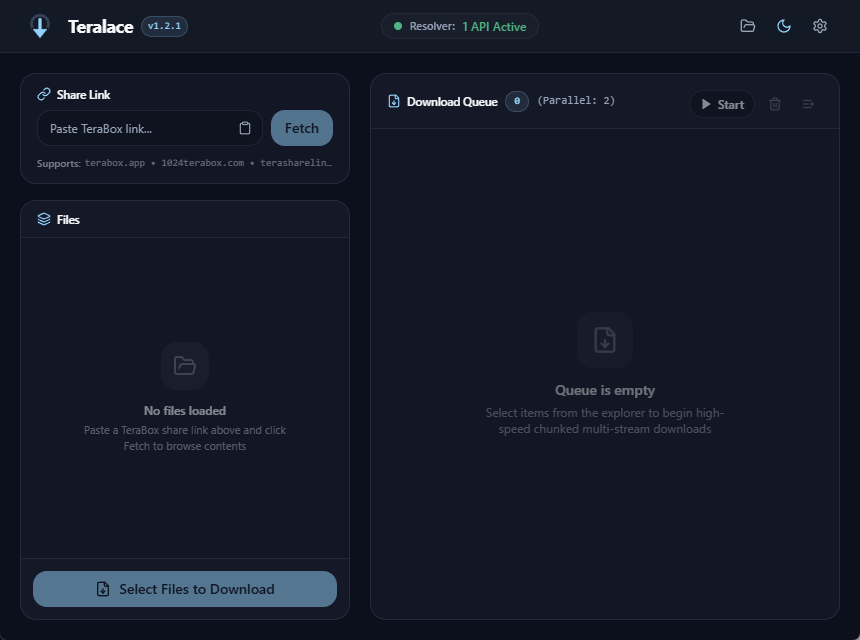

<p align="center">
  
</p>

<h1 align="center">Teralace</h1>

<p align="center">
  <strong>Fast, resilient, multiplatform TeraBox downloader powered by Tauri v2 &amp; Rust.</strong><br>
  Engineered for <strong>Windows</strong>, <strong>macOS</strong>, <strong>Linux</strong>, and <strong>Android</strong> with zero external dependencies.
</p>

<p align="center">
  <a href="https://github.com/LoLyeah/teralace/releases/latest"></a>
  
  
  
  
</p>

<p align="center">
  
</p>

---

## 📥 Downloads

Pre-compiled, release-ready packages for all platforms are available on the **[GitHub Releases Page](https://github.com/LoLyeah/teralace/releases/latest)**:

| Platform | Type | Format | Architecture | Download Link |
|:---|:---|:---|:---|:---|
| **Windows** | Standard Installer | Setup `.exe` | x86_64 | [**Setup `.exe`**](https://github.com/LoLyeah/teralace/releases/latest) |
| **Windows** | Portable Archive | `.zip` | x86_64 | [**Portable `.zip`**](https://github.com/LoLyeah/teralace/releases/latest) |
| **macOS** | Universal Bundle | `.dmg` | Apple Silicon (`M1–M4`) & Intel (`x64`) | [**Universal `.dmg`**](https://github.com/LoLyeah/teralace/releases/latest) |
| **Linux** | Portable AppImage | `.AppImage` | x86_64 (`amd64`) | [**Portable `.AppImage`**](https://github.com/LoLyeah/teralace/releases/latest) |
| **Linux** | Debian Package | `.deb` | x86_64 (`amd64`) | [**Native `.deb`**](https://github.com/LoLyeah/teralace/releases/latest) |
| **Android** | Signed Package | `.apk` | Universal (`ARM64` / `x86_64`) | [**Universal `.apk`**](https://github.com/LoLyeah/teralace/releases/latest) |

---

## ✨ Features & Highlights

### ⚡ Pure Rust Multi-Stream Download Engine
* **Concurrent Chunk Downloader:** Multi-threaded HTTP Range streaming that saturates network connections with parallel chunk chunking and auto-stitch.
* **Zero External Dependencies:** Built with pure asynchronous Rust (`tokio` + `reqwest`). No external `aria2c` binaries or Python wrappers required.
* **Instant Pause & Resume:** Full byte-accurate state persistence allowing downloads to pause, resume, or recover gracefully from drops.
* **Bandwidth Throttling:** Built-in speed limiters with customizable presets (512 KB/s, 1 MB/s, 2 MB/s, 5 MB/s, 10 MB/s, or Unlimited).

### 🛡️ Multi-Tier Resilient Resolution
* **Dynamic API Pool Load Balancer:** Round-robin balancing across multiple endpoints with automatic failover, active reachability probing, and a 120s circuit breaker for failing or rate-limited nodes.
* **Self-Hostable Cloudflare Worker:** Free, private serverless reverse-proxy script included in [`cloudflare-worker/`](./cloudflare-worker/README.md) for 100% resolver uptime.
* **WAP Direct Scraper Fallback:** High-speed mobile WAP scraper generating direct pre-signed download tokens when API pools are unavailable.
* **Deep Pagination:** Full pagination support for large folders and shares containing more than 20, 50, or 100+ files.
* **Recursive Folder Expansion:** Automatic recursive traversal into shared subdirectories.
* **50+ Domain Mirrors:** Universal regex normalizer resolving all TeraBox domains (`1024terabox.com`, `terabox.app`, `terasharelink.com`, `nephobox.com`, `4funbox.com`, `mirrobox.com`, etc.).

### 📱 Modern Multiplatform Experience
* **Desktop & Mobile Optimized:** Responsive layout with desktop controls (folder opener, window controls, background downloads) and dedicated touch-friendly tabs on Android.
* **One-Tap In-App Login:** Native sign-in popup that auto-captures and saves your TeraBox `ndus` session cookie without requiring browser DevTools.
* **In-App Diagnostic Log Viewer:** Integrated real-time ring buffer logger in Settings to view errors, trace requests, and diagnose network issues directly inside the app.
* **In-App Media Streaming:** Instant video and audio player preview before or during download.
* **Material You Dynamic Theming & Vector Branding:** Pure geometric circle & piercing arrow branding engineered with safe-zone compliance, seamless dynamic monochrome theming, and selectable Material 3 tonal color palettes including wallpaper Monet auto-detection.
* **Private Downloads & Speed Unlock:** Personal `ndus` session cookie support to bypass guest bandwidth limits and fetch private shared folders.

---

## 🛠️ Development & Building

### Prerequisites
* **Node.js** v20+ & **npm**
* **Rust** stable (latest)
* **Android SDK & NDK** (for building Android APKs)

### Getting Started

```bash
# Clone the repository
git clone https://github.com/LoLyeah/teralace.git
cd teralace

# Install dependencies
npm install

# Run Vite dev server (browser preview)
npm run dev

# Run Tauri desktop development (hot reload)
npm run tauri dev
```

### Production Compilation

```bash
# Windows Desktop (Installer & Portable)
npm run tauri build

# macOS Universal Binary (Apple Silicon + Intel)
npm run tauri build -- --target universal-apple-darwin

# Android Signed Release APK
npm run tauri android build --apk --target aarch64 --ci
```

---

## ⚙️ Configuration & Tips

### 1. Personal Session (`ndus` Cookie)
TeraBox blocks anonymous downloads for shared folders or large files (`31045: user not exists`). To enable high-speed downloads:
* **Option A (One-Tap In-App):** Open **Settings** &rarr; **TeraBox Cookie** &rarr; click **Sign In to TeraBox**. Log in once and Teralace will automatically capture and save your session cookie!
* **Option B (Android — Kiwi Browser + Cookie-Editor, 100% Guaranteed):**
  Because TeraBox flags the `ndus` session cookie as **`HttpOnly`** on most regions, mobile browser JavaScript is forbidden by security design from reading it. The reliable mobile solution is:
  1. Install **Kiwi Browser** from the Google Play Store (which supports Chrome extensions).
  2. Install the **Cookie-Editor** extension from the Chrome Web Store in Kiwi.
  3. Open [terabox.app](https://www.terabox.app/), log in, tap `⋮` &rarr; **Cookie-Editor**, and copy the `ndus` cookie value.
  4. Return to Teralace and tap **Paste**.
* **Option C (Android — Chrome Bookmarklet Overlay):** 
  If your TeraBox regional domain allows client-accessible storage:
  1. In Teralace **Settings** &rarr; **TeraBox Cookie**, tap **Copy Helper Bookmarklet**.
  2. In Chrome on Android, bookmark any page (`⋮` &rarr; `★`), tap **Edit**, set the bookmark name to `ndus`, clear the URL field, and paste the bookmarklet script.
  3. Open [terabox.app](https://www.terabox.app/) in Chrome and log in.
  4. Tap the Chrome address bar, type `ndus`, and tap the suggestion with the **★ Bookmark** icon *(do not tap Search or press Enter)*.
  5. An on-page floating card will appear allowing 1-tap copy of your `ndus` token.
* **Option D (Desktop DevTools):** Open [TeraBox Web](https://www.terabox.app/), log in, press <kbd>F12</kbd> &rarr; **Application** &rarr; **Cookies**, copy the `ndus` value, and paste it into **Settings** &rarr; **TeraBox Cookie**.

### 2. Custom API Pool & Self-Hosted Cloudflare Worker
Teralace features an automatic round-robin balancer and circuit-breaker. When public endpoints are throttled, running your own private Cloudflare Worker gives you 100% uptime and dedicated extraction bandwidth for **free** (100,000 requests/day).

#### 🚀 2-Minute Web Dashboard Setup (No CLI Required):
1. **Create Worker:** Log into the [Cloudflare Dashboard](https://dash.cloudflare.com/) &rarr; navigate to **Compute (Workers)** &rarr; **Workers & Pages** &rarr; **Create Worker**.
2. **Name & Deploy:** Name it `teralace-resolver` and click **Deploy**.
3. **Paste Script:** Click **Edit Code** (Quick Edit), delete the default sample code, and paste the code from [`cloudflare-worker/worker.js`](./cloudflare-worker/worker.js) (or click **Copy worker.js Script** inside Teralace Settings). Click **Deploy**.
4. **Connect in Teralace:** Copy your worker URL (`https://teralace-resolver.<subdomain>.workers.dev/`), open Teralace **Settings** &rarr; **API Pool & Balancer**, paste it into **Base URL**, and click **+ Add**.

*(Optional)* Under Worker **Settings &rarr; Variables and Secrets**:
* `AUTH_TOKEN`: Password-protect your worker (input the same token into Teralace's *Auth Token* field).
* `TERABOX_COOKIE`: Pre-set your personal `ndus` cookie so all extractions automatically authenticate.

See [`cloudflare-worker/README.md`](./cloudflare-worker/README.md) for Wrangler CLI deployment and health checks.

---

## 📄 License & Acknowledgments

* **License:** Distributed under the **GNU General Public License v3.0 (GPL-3.0)**.
* **Core Inspirations:**
  * Fetch engine patterns inspired by [abdul97233/TeraBox-Downloader-Bot](https://github.com/abdul97233/TeraBox-Downloader-Bot).
  * UI foundation inspired by [aruxyz/trauso](https://github.com/aruxyz/trauso).
